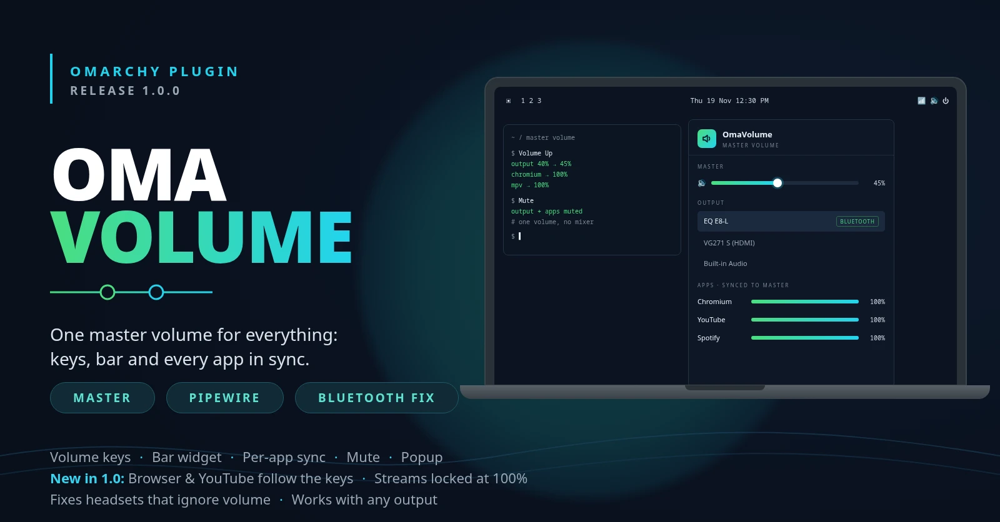

# OmaVolume: one master volume for Omarchy



Video in the browser ignores your volume keys? On Omarchy, apps and Bluetooth
headsets can each keep their own volume, so the keys seem to do nothing.
OmaVolume makes the output volume the only one that matters.

- **Bar widget**: master volume slider, output picker and per-app mixer. Moving the
  volume or muting raises every app stream (browser, YouTube, players) that sits below
  100% back to 100%, and a stream that shows up later is synced shortly after it appears.
  What it leaves alone on purpose: a stream you boosted above 100%, every stream's mute
  state (a muted tab stays muted) and the speaker-tuning stream. This is the "master"
  part: a stream you turn down in the per-app mixer goes back to 100% at the next volume
  change. Set `masterSync` to `false` (see Settings) to keep the mixer's levels.
- **Volume keys**: `master-volume` runs Omarchy's own volume command (with its
  on-screen popup) and does the same sync, reading the stream list once per key press.
- **Bluetooth fix**: some headsets ignore the hardware (AVRCP) volume PipeWire sends,
  so only mute worked. A small WirePlumber setting makes PipeWire apply the volume itself.
  It applies to **every** Bluetooth device, not just the broken one: a headset whose own
  buttons used to track the system volume will stop doing that. Delete the file to undo it.

**Compatibility:** works with Omarchy 4.5 (checked on 4.5.0-3: manifest validation, the plugin's own tests, and every Omarchy component, command and bar interface it uses).

## What's new in 1.1.1

- Housekeeping: 1.1.0 accidentally included two Python bytecode files (`__pycache__`); they are removed and ignored.
  No behaviour change. The install commands in this README now use the repository's current GitHub address.

## What's new in 1.1.0

- **One audio icon, not two.** Enabling OmaVolume (`omarchy plugin add ... --enable`) used to add its icon next to
  Omarchy's own audio icon, so the bar showed two. Now, the first time it runs, OmaVolume takes the place of Omarchy's
  audio icon, in the same spot (any bar section), and moves that icon's settings to the `plugins` list. It runs once:
  if you later put Omarchy's icon back, nothing swaps it again. Undo it any time with
  `python3 -I ~/.config/omarchy/plugins/blackcode.omavolume/omavolume unswap`; run
  `omavolume setup --force` to do it again.
- It changes `shell.json` safely: atomic, locked, re-checked just before the write, symlinks kept, and the first file it
  changed is kept as `shell.json.omavolume-original` (plus the last 3 earlier versions).

## What's new in 1.0.1

- The sync no longer unmutes streams, no longer pulls down a stream you boosted above 100%,
  and skips the speaker-tuning stream. A muted tab stays muted.
- `master-volume` reads the stream list once per key press (was two `pactl` calls per stream)
  and passes on the exit status of Omarchy's volume command.
- The widget syncs a new stream shortly after it appears, in case its audio was not ready.
- `install.sh`: refuses to replace a plugin folder installed another way, backs up a different
  WirePlumber file, `--no-restart` skips restarting WirePlumber, and commented-out binding
  lines no longer count as installed.
- LICENSE now credits Omarchy; README lists the full uninstall and the Bluetooth setting's
  side effect on all Bluetooth devices. Tests: `bash tests/test-omavolume.sh`.

## Install

The widget alone (the sync happens when you use the widget). It replaces Omarchy's own audio icon, so you do not get two:

```bash
omarchy plugin add https://github.com/blackcodesh/omavolume --enable
```

The whole thing (widget, volume keys, Bluetooth fix). Clone the repo and run the
installer; it is safe to run again:

```bash
git clone https://github.com/blackcodesh/omavolume
cd omavolume && ./install.sh
```

The installer links the plugin into `~/.config/omarchy/plugins/`, links
`master-volume` into `~/.local/bin/`, adds the key bindings and a `SUPER + CTRL + A`
binding that opens this widget's panel to `~/.config/hypr/bindings.lua` (once each;
commented-out lines don't count), and installs the Bluetooth setting (a different file already
there is kept as `...conf.bak-<time>`). It refuses to run if the plugin folder or script
already exists as a real folder or file, for example from `omarchy plugin add`: remove that
first. When the Bluetooth setting changes it restarts WirePlumber, which briefly drops audio
and Bluetooth; `./install.sh --no-restart` skips that. The installer does not enable the
widget: run `omarchy plugin enable blackcode.omavolume`. The first time it runs, it replaces Omarchy's own audio
icon on the bar, so there is a single audio icon (see "What's new in 1.1.0").

Also listed in the Omarchy plugin marketplace (https://plugins.omarchy.org): search for **OmaVolume**.

## Files

| Path | What it is |
|------|------------|
| `manifest.json`, `Panel.qml`, `Model.js` | The bar widget, plugin id `blackcode.omavolume` |
| `Service.qml`, `omavolume` | First-run setup: swaps Omarchy's audio icon for this one (`setup`, `unswap`) |
| `scripts/master-volume` | What the volume keys run |
| `config/bindings.lua.snippet` | Key bindings appended to `bindings.lua` |
| `config/51-bluez-software-volume.conf` | WirePlumber fix for headsets that ignore hardware volume |
| `install.sh` | Links everything into place |

## Settings

Set `property bool masterSync: false` in `Panel.qml` to stop the widget syncing
app streams (an edit to an installed copy is overwritten by `omarchy plugin update`).

## Uninstall

Put Omarchy's own audio icon back first, while the plugin is still installed:

```bash
python3 -I ~/.config/omarchy/plugins/blackcode.omavolume/omavolume unswap
omarchy plugin remove blackcode.omavolume
```

If you used `install.sh`, also: remove the "Master volume" block and the `SUPER + CTRL + A`
(OmaVolume panel) line from `~/.config/hypr/bindings.lua` (Omarchy's own `SUPER + CTRL + A`
binding comes back), delete `~/.config/wireplumber/wireplumber.conf.d/51-bluez-software-volume.conf`
and restart WirePlumber, `rm ~/.local/bin/master-volume`, and delete the link
`~/.config/omarchy/plugins/blackcode.omavolume` (only the link: `omarchy plugin remove` on a
linked plugin has not been tested here).

## Credits and tests

`Panel.qml` and `Model.js` are derived from Omarchy's built-in audio plugin (`omarchy.audio`,
MIT, copyright David Heinemeier Hansson); the added code is MIT, copyright BlackCode. Tests (all in
throwaway folders): `bash tests/test-omavolume.sh` for the key script and the installer, and
`python3 -I -m unittest discover -s tests -p "test_*.py"` for the setup tool.

## License

MIT, see [LICENSE](LICENSE). `Panel.qml` and `Model.js` are derived from Omarchy's built-in audio plugin (MIT, copyright David Heinemeier Hansson); the added code is copyright BlackCode.
